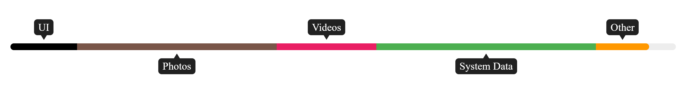
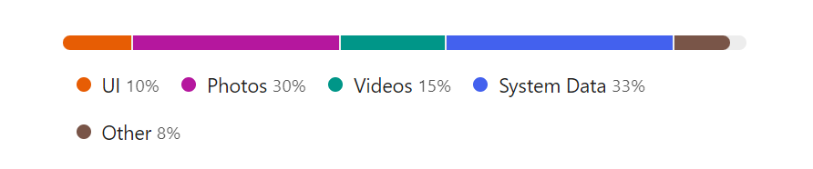

# React Usage Bar Graphic Component





[](https://opensource.org/licenses/MIT)

Display disc sectors, stats and more with this lightweight user-friendly React component.\
Now compatible with [Tailwind](https://tailwindcss.com/).

## Installation

Install via npm

```sh
npm install react-usage-bar --save
```

or yarn

```sh
yarn add react-usage-bar
```

<br>

## Compatibility table

| Package v | Node       | React          |
| --------- | ---------- | -------------- |
| <= 1.1.18 | <= 16.14.x | 16.x - 17.x   |
| >= 1.1.19 | 18.x.x     | 18.x           |
| >= 1.2.2  | 20.x.x     | 18.x           |
| >= 1.3.0  | 20.x.x     | 18.x - 19.x   |

<br>

## Usage

Live **demo** at: [https://chrisuser.github.io/react-usage-bar/](https://chrisuser.github.io/react-usage-bar/)

The usage bar needs to receive an array of items. In order to display all the values correctly every item should follow this interface:

### Item type

| Attribute    | Type   | Required |                                                                                        |
| ------------ | ------ | -------- | -------------------------------------------------------------------------------------- |
| value        | number | Yes      |                                                                                        |
| name         | string | Yes      |                                                                                        |
| color        | string | No       | Supports hex, rgb, hsl, named colors, and CSS gradients                                |
| className    | string | No       |  |
| dotClassName | string | No       |  |

The `value` attribute indicates the amount of space taken up by the sector with a specific `name`. The `color` property can be utilized to define the background color of that particular portion in the bar. It also supports CSS gradients like `linear-gradient(90deg, #4facfe, #00f2fe)`.

To further customize the sector element, you can apply your own CSS classes or Tailwind classes using the `className` attribute.

In case you are using the **compact layout** and have not specified a `color` value, you can customize the `dotClassName` similarly to the `className` attribute.

> The defined `color` property value will have a **priority on the background color** defined in the `className` and/or `dotClassName` ones.\
> <br />
> It is recommended to use **exclusively** `color` or one of the two other properties per item.

### Example

```tsx
import UsageBar from 'react-usage-bar'
import 'react-usage-bar/dist/index.css'

const App = () => {
    const itemsToDisplay = [
        {
            name: 'UI',
            value: 10,
            color: '#000000'
        },
        {
            name: 'Photos',
            value: 30
        },
        {
            name: 'Videos',
            value: 15
        },
        {
            name: 'System Data',
            value: 33
        },
        {
            name: 'Other',
            value: 8
        }
    ]

    return <UsageBar items={itemsToDisplay} total={100} showFallbackColors />
}

export default App
```

The `total` prop is also required.

<br>

## TypeScript

The `Item` and `UsageBarProps` types are exported and can be imported for use in your own code:

```tsx
import UsageBar, { type Item, type UsageBarProps } from 'react-usage-bar'

const items: Item[] = [
    { name: 'Photos', value: 30, color: '#E85D04' },
    { name: 'Videos', value: 15 }
]
```

<br>

## Props (Options)

### Core

### **items** | _Item[]_ | **required**

The array of items to display in the bar.

### **total** | _number_ | **required**

The total value representing 100% of the bar.

### **showPercentage** | _boolean_ | default: `false`

When true, shows the percentage value of all the elements.

### **showLabels** | _boolean_ | default: `true`

When false, hides all the tooltips or labels of the items.

### **darkMode** | _boolean_ | default: `false`

When true, enables the component to work in dark-mode.

### **compactLayout** | _boolean_ | default: `false`

When true, enables the compact design with labels below the bar instead of tooltips.

### **showFallbackColors** | _boolean_ | default: `false`

When true, dynamically assigns a color from the built-in palette to items without an explicit `color` value.

### **errorMessage** | _string_ | default: `Error: Total elements values exceed 100%.`

Customize the error string that appears when the total values of the provided items exceeds 100%.

---

### Appearance

### **height** | _number | string_ | default: `8pt`

Controls the height of the bar. Numbers are treated as pixels.

### **borderRadius** | _number | string_ | default: `4pt`

Controls the border radius of the bar. Numbers are treated as pixels.

### **segmentGap** | _number_

Spacing in pixels between segments. When set, each segment becomes individually rounded.

### **segmentBorderRadius** | _number_

Per-segment border radius in pixels. Overrides the default segment rounding.

### **animated** | _boolean_ | default: `false`

When true, segments smoothly animate their width changes via CSS transitions.

### **transitionDuration** | _number_ | default: `0.4`

Duration of the segment width animation in seconds. Only applies when `animated` is true.

### **rtl** | _boolean_ | default: `false`

When true, renders the bar in right-to-left direction.

---

### Interaction

### **showTooltipOnHover** | _boolean_ | default: `false`

When true, tooltips are hidden by default and only appear when hovering over a segment. Hovered segments are highlighted.

### **onItemClick** | _(item: Item, index: number) => void_

Callback fired when a bar segment is clicked. Does not apply to the remaining segment.

---

### Custom Rendering

### **renderTooltip** | _(item: Item, percentage: string) => ReactNode_

Custom render function for tooltip or label content. Receives the item and its percentage string.

### **renderSegment** | _(item: Item, percentage: string, defaultStyle: CSSProperties) => ReactNode_

Custom render function for the entire bar segment. Receives the item, percentage string, and a style object containing `width`, `backgroundColor`, animation, and border-radius values. Apply `defaultStyle` to your element for correct sizing.

### **remaining** | _{ name: string; color?: string }_

When provided, an additional segment is added to the bar representing the unused space (`total - sum of items`). Useful for storage-style UIs.

```tsx
<UsageBar items={items} total={100} remaining={{ name: 'Available', color: '#e0e0e0' }} />
```

---

### Accessibility

### **ariaLabel** | _string_ | default: `Usage bar`

Sets the `aria-label` on the root container. Each segment automatically gets `role="meter"` with `aria-valuenow`, `aria-valuemin`, `aria-valuemax`, and `aria-label` attributes.

---

<br>

**Custom classes props:** add custom or Tailwind classes to elements of the component.

### **className** | _string_

Standard React `className` applied to the root container div.

### **usageBarContainerClassName** | _string_

Can customize the main div of the component.

### **usageBarClassName** | _string_

Can customize the actual bar element of the component.

### **tooltipClassName** | _string_

Can customize the tooltip div of the item in which are written all the textual info.

### **errorMessageClassName** | _string_

Can customize the style of the error message.

<br>

## CSS Styles

You must import the style directly from the package directory, like this:

```javascript
import 'react-usage-bar/dist/index.css'
```

The project variables are:

-   `--text-color`
-   `--background-tooltip-color`
-   `--background-bar-color`

The main css classes are the following:

### `.u-UsageBar__error`

The error message.

### `.u-UsageBar-light`

The class that contains all the colors for the light mode.

### `.u-UsageBar-dark`

The class that contains all the colors for the dark mode.

### `.c-UsageBar`

The main div of the component.

### `.o-UsageBar__bar`

The actual bar of the component.

### `.o-UsageBar__bar__element`

The single item represented in the bar. This class is vastly used.

### `.o-UsageBar__bar__tooltip`

The tooltip of the item in which are written all the textual info.

-   `.o-UsageBar__bar__tooltip__percentage` - Used to control the style of the percentage labels.
-   `::after` - Is used to make the triangular shape on the bottom (or top) of the tooltips.

### `.o-UsageBar__bar--hover-tooltips`

Applied to the bar when `showTooltipOnHover` is enabled. Hides tooltips by default and shows them on segment hover.

### `.o-UsageBar__bar__elements__labels__container`

Used in the compact layout to list all the labels for the elements.

### `.o-UsageBar__bar__elements__label`

The labels for the elements of the bar.

### `.o-UsageBar__bar__elements__label--dot`

The colored dot before the label of the elements.

<br>

## Docs

You can run the project in a local environment using [Storybook](https://storybook.js.org/):

```
$ yarn storybook
```

<br>

## Contribution

If you have a suggestion that would make this component better feel free to fork the project and open a pull request or create an issue for any idea or bug you find.\
Remember to follow the [Contributing Guidelines](https://github.com/ChrisUser/.github/blob/main/CONTRIBUTING.md).

<br>

## Licence

React Usage Bar is [MIT licensed](https://github.com/ChrisUser/react-usage-bar/blob/master/LICENSE).
